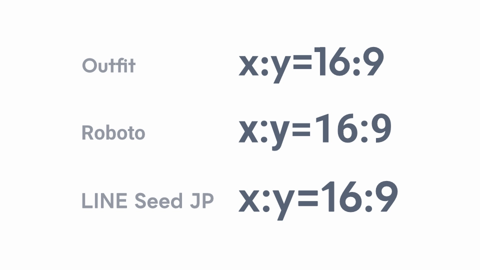

## はじめに

https://x.com/mizz_noff/status/2094915704323776629

先日リリースしたOBS Studioプラグイン「フォントな時計」が、大きな反響をいただきました。ありがたいことです。
リリース後も改善を重ね、ある程度は成熟したプロダクトになったのではないかと思います。

## 配信画面のデジタル時計の【:】は、なぜそこにあるのか

配信画面に置かれているデジタル時計では、このようにコロン【:】が数字の底辺に揃っているか、そうでなくても中央より下側にあることが多いですよね。
一方で、テレビのニュース番組などで表示されているデジタル時計だと、コロンの位置は必ずと言っていいほど中央になっているはずです。

では、配信画面の時計のコロンの位置は何に由来するのでしょうか。
それは……

フォントで規定されたデフォルトの位置です。

そしてコロンがこのような位置にあるケースの多くでは、コロンは数字ではなくアルファベットの小文字に揃えられています。

上の図でいえば、`x:y`のコロンの位置はちょうどいいと感じられますよね。

つまり、**コロン【:】の位置はデジタル時計という用途を想定したものではない**といえるでしょう。
そして、**「デジタル時計素材のコロンは数字の中央に揃っていた方が美しい」というのが私の考え**です。

（ちなみに、コロンの位置についてはAdobeさんも同じ考えを示しています）
https://www.adobe.com/jp/creativecloud/roc/blog/design/quiz-challenge/baseline.html

しかし、多くのデジタル時計素材では、コロンの位置はフォントで規定されたデフォルトのままです。
もし「コロンはデフォルトの位置で使用するのが美しい」という信念を持って制作されているのであればそれを否定はしませんが、そのように感じられるデジタル時計素材を私は見たことがありません。

せっかく趣向を凝らしてデザインされている素材でも、そのような減点法のケアがされていないともったいなく感じてしまいます。

## なぜ「フォントな時計」の制作に至ったのか

ここまで言うぐらいですから、「フォントな時計」はもちろんコロンの位置を調整できるようになっています。
というより、**「デジタル時計のコロンの位置を調整する」という概念をVTuberシーンに浸透させたい**というのが「フォントな時計」の制作動機だったのです。
コロンの位置を自動サジェストするだけでなく、手動でも調整できるようになっているのにはそうした背景があります。

### なぜコロンの位置にこだわるのか

いやお前、たかがコロンの位置に執着しすぎだろう、と。それはそうですよね。

正直に言うと、その理由の半分は「私の目にする世界が美しいものであってほしい」というエゴです。
VTuberシーンを追うことは私にとってライフワークのようなものなので、日頃から目に入る景色は美しくあってほしいのです。

ただ、理由のもう半分は真面目です。
VTuberシーンのデザインは独自の魅力にあふれているじゃないですか。VTuberシーンに出会った頃はデザイン書体がふんだんに使われているのにワクワクしましたし、ポップと洗練が両立した配信アセットなんかを見かけると嬉しくなってしまいます。

だからこそ、そういう文化がコロンの位置ひとつで「ナメられてほしくない」んですよね。
つまりは、**VTuber文化の足元を固めるのに貢献したい**ということです。

ちなみに、昨年リリースしたアイコン整列ツール（凸待ち配信などを想定）も、同じ思いで制作しています。
https://mizznoff.booth.pm/items/7025907

### なぜWebフォントにとらわれないといけないのか

「コロンの位置を調整する」という概念を布教させるため、最初に作成したのはこんな感じの時計素材です。

ところが、このように洗練されたシンプルな時計というのは「上手く宣伝できるビジョンが見えない」のです。

2010年代ならともかく、競合が多数存在する2026年に新たな時計素材をヒットさせたいとなると、相当インパクトのある要素を織り込む必要がありました。
一方で、コロンの位置に注目してもらうためにはシンプルなデザインであるべきだという考えもあったので、どうしたものかとしばらく思い悩んでいました。

そんな悩みを抱えながらGoogle Fontsの数字フォントを端から端まで眺めていたところ、「ひょっとしてGoogle Fontsの表現力には限界があるのでは？」と気づいたのです。

ライブ配信向けのデジタル時計素材のほとんどはhtml形式（つまりWebベース）であり、Google Fontsのフォントを使用しているケースが多いです。
ところがGoogle FontsのフォントはあくまでWebサイトでの使用を想定したものであり、フォントの「個性」はそこまで強くないという肌感がありました。

せっかくVTuberシーンではたくさんの個性的なデザイン書体が使用されているのだから、それらをデジタル時計素材として使用できるようになればゲームチェンジャーでは……？

ということで出来上がったのが「フォントな時計」だったのです。
配信画面のひとつの記号の位置を調整するにとどまらず、VTuberシーンの魅力をより引き出すツールになったのではないかと自負しています。

## おわりに
