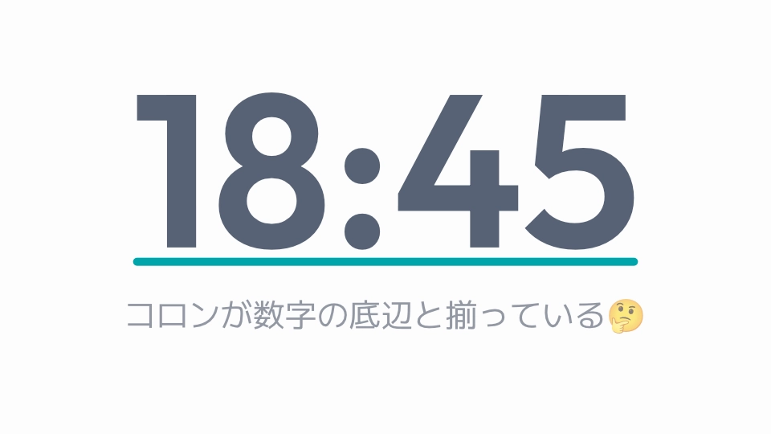
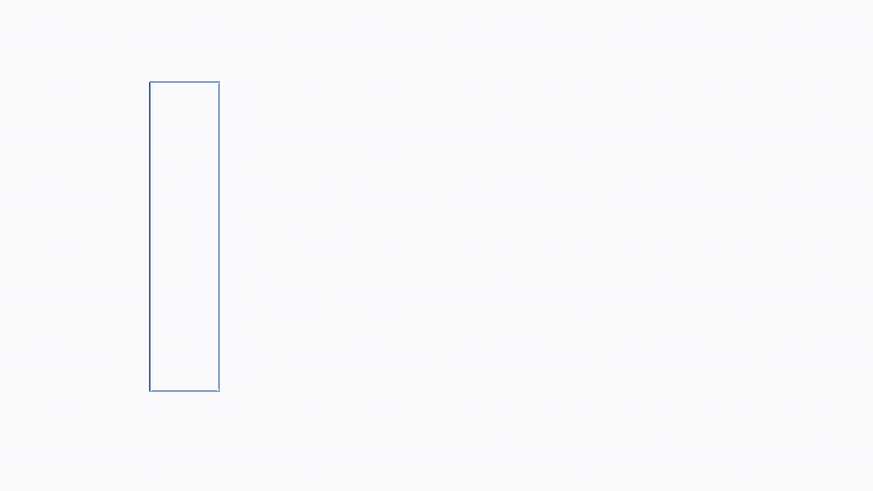

## はじめに

https://x.com/mizz_noff/status/2094915704323776629

先日リリースしたOBS Studioプラグイン「フォントな時計」が、大きな反響をいただきました。ありがたいことです。
リリース後も改善を重ね、ある程度は成熟したプロダクトになったのではないかと思います。

## 配信画面のデジタル時計の【:】は、なぜそこにあるのか

配信画面に置かれているデジタル時計では、このようにコロン【:】が数字の底辺に揃っているか、そうでなくても中央より下側にあることが多いですよね。
一方で、テレビのニュース番組などで表示されているデジタル時計だと、コロンの位置は必ずと言っていいほど中央になっているはずです。

では、配信画面の時計のコロンの位置は何に由来するのでしょうか。
それは……

フォントで規定されたデフォルトの位置です。

そしてコロンがこのような位置にあるケースの多くでは、コロンは数字ではなくアルファベットの小文字に揃えられています。

上図でいえば、`x:y`のコロンの位置はちょうどいいと感じられますよね。

つまり、**コロン【:】の位置はデジタル時計という用途を想定したものではない**といえるでしょう。
そして、**「デジタル時計素材のコロンは数字の中央に揃っていた方が美しい」というのが私の考え**です。

ところが、多くのデジタル時計素材ではフォントで規定されたデフォルトの位置にコロンが置かれています。
もし「コロンはデフォルトの位置で使用するのが美しい」という信念を持って制作されているのであればそれを否定はしませんが、そのように感じられるデジタル時計素材を私は見たことがありません。

せっかく趣向を凝らしてデザインされている素材でも、そのような減点法のケアがされていないともったいなく感じてしまいます。
